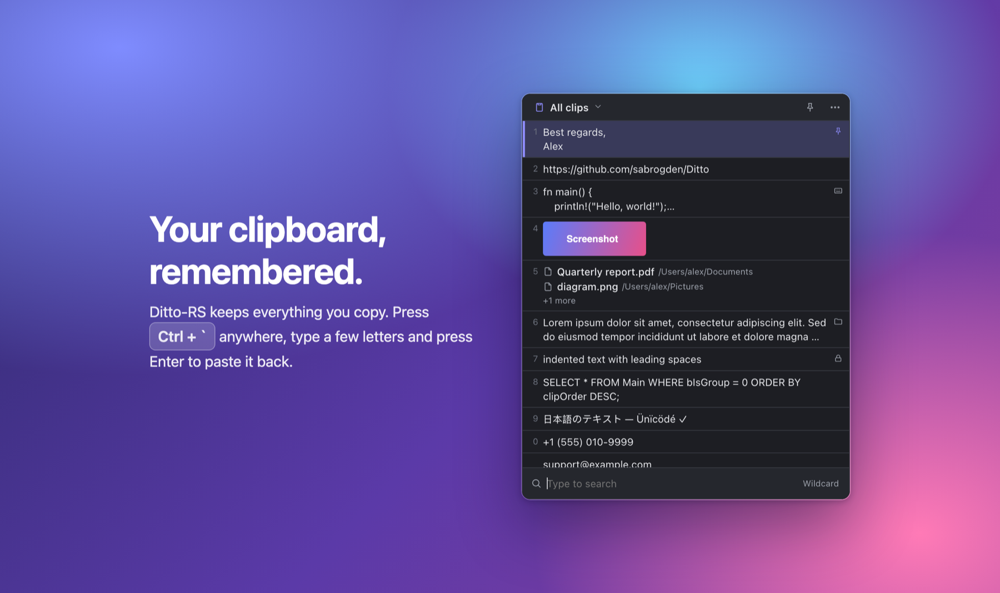
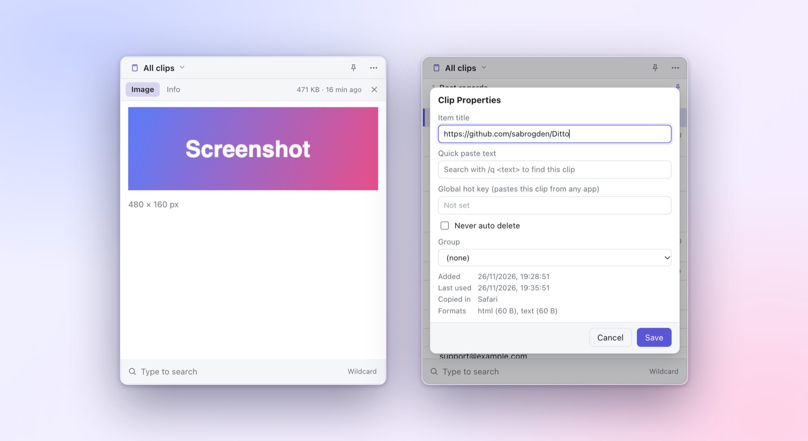
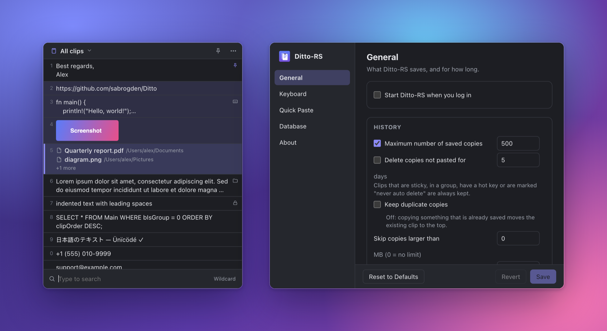
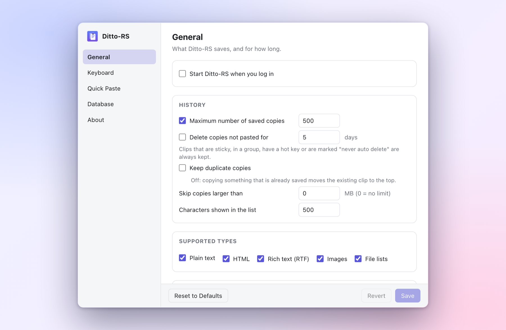

<div align="center">


# Ditto-RS

**A fast, keyboard-first clipboard manager for Windows, macOS and Linux.**<br>
A cross-platform re-creation of [Ditto](https://github.com/sabrogden/Ditto), written in Rust.

[](https://github.com/krynv/ditto-rs/releases/latest)
[](https://github.com/krynv/ditto-rs/actions/workflows/ci.yml)

[](LICENSE)

[**⬇ Download**](https://github.com/krynv/ditto-rs/releases/latest) &nbsp;·&nbsp; [**Website and live demo**](https://krynv.github.io/ditto-rs/) &nbsp;·&nbsp; [Features](#features) &nbsp;·&nbsp; [Keyboard](#keyboard) &nbsp;·&nbsp; [Build from source](#build-from-source)



</div>

Ditto-RS keeps a searchable history of everything you copy (text, rich text, images and
files). Press **Ctrl + \`** anywhere, type a few letters and hit **Enter**: the clip is pasted
straight into the app you were using. If you have used Ditto on Windows you already know how
it works, and now it works on your Mac and your Linux box too.

## Download

Grab the latest build from the **[Releases page](https://github.com/krynv/ditto-rs/releases/latest)**:

| Platform | Download | First launch |
|---|---|---|
| **macOS** 10.15+ (Apple silicon & Intel) | `Ditto-RS_<version>_universal.dmg` | The app is not notarized yet. After the first launch attempt, open **System Settings → Privacy & Security** and click **Open Anyway** (or run `xattr -dr com.apple.quarantine /Applications/Ditto-RS.app`). Allow **Accessibility** access when asked so it can paste for you. |
| **Windows** 10/11 | `Ditto-RS_<version>_x64-setup.exe` or `.msi` | SmartScreen may warn about an unknown publisher: **More info → Run anyway**. |
| **Linux** | `.AppImage`, `.deb` or `.rpm` | Needs WebKitGTK 4.1 and an AppIndicator-capable tray. See [Wayland notes](#platform-notes). |

Ditto-RS lives in the system tray / menu bar. Launching it again opens the quick-paste window.

## Features

<table>
<tr>
<td width="50%"></td>
<td width="50%"></td>
</tr>
</table>

- **Everything you copy, kept**: plain text, HTML, RTF, images (with thumbnails) and file lists,
  stored locally in SQLite. Copy something again and it simply jumps back to the top.
- **Find as you type**: words are ANDed, with `OR`, `NOT`, `"exact phrases"`, `*` wildcards,
  regular expressions, and `/f` (full text) or `/q` (quick-paste text) prefixes.
- **Paste where you were**: focus goes back to the previous app and the paste keystroke is sent
  for you. **Shift + Enter** pastes plain text.
- **Special Paste**: UPPER / lower / Capitalize / Sentence / Invert case, trim, CamelCase,
  ASCII only, remove or add line feeds, append the current time, Slugify, Typoglycemia, Posixify
  paths, and combine several images side by side or stacked.
- **Multi-paste**: select several clips and paste them together (your separator, oldest first).
- **Organise**: sticky clips pinned to the top, groups and sub-groups, manual ordering, titles,
  "never auto delete", and *quick-paste text* to find a clip by a short name.
- **Hotkeys everywhere**: open the window, paste clip 1–10 without opening it, give any clip its own
  global hotkey, or paste the clipboard as plain text.
- **Private by design**: nothing leaves your machine. Copies that password managers mark as secret
  are skipped, and you can exclude apps by name.
- **Moving from Ditto?** *Options → Database → Import Ditto Database…* brings over your clips,
  groups, sticky clips, quick-paste text and hotkeys from `Ditto.db`.
- Light & dark themes, adjustable lines per clip and font size, portable mode, tray menu, statistics,
  backup and compact.

<p align="center"></p>

## Keyboard

| In the quick-paste window | |
|---|---|
| <kbd>Enter</kbd> / double-click | Paste the selected clip(s) |
| <kbd>Shift</kbd> + <kbd>Enter</kbd> | Paste as plain text |
| <kbd>Ctrl</kbd> + <kbd>1</kbd> … <kbd>0</kbd> | Paste clip 1–10 |
| <kbd>Shift</kbd> + <kbd>↑</kbd>/<kbd>↓</kbd>, <kbd>Ctrl</kbd>/<kbd>Shift</kbd> + click | Select several clips |
| <kbd>F3</kbd> | View the whole clip (text, HTML, RTF, image, files, info) |
| <kbd>F2</kbd> / <kbd>Ctrl</kbd> + <kbd>E</kbd> | Edit the clip |
| <kbd>Alt</kbd> + <kbd>Enter</kbd> | Clip properties |
| <kbd>Ctrl</kbd> + <kbd>N</kbd> | New clip |
| <kbd>F7</kbd> / <kbd>Ctrl</kbd> + <kbd>F7</kbd> | New group from the selection / new group |
| <kbd>Ctrl</kbd> + <kbd>G</kbd> | Switch group |
| <kbd>Ctrl</kbd> + <kbd>Space</kbd> | Keep the window open |
| <kbd>Del</kbd> | Delete the selected clip(s) |
| <kbd>Esc</kbd> | Clear the search, then close |

On macOS, <kbd>⌘</kbd> works wherever <kbd>Ctrl</kbd> is listed. Right-click a clip for everything
else: Special Paste, clip order, sticky clips, groups and quick properties.

## Platform notes

- **macOS**: pasting needs *Accessibility* access (System Settings → Privacy & Security →
  Accessibility). Until it is granted, clips are copied and you paste with ⌘V yourself.
- **Linux (X11)**: everything works. **Wayland**: apps cannot register global hotkeys or move
  focus, so bind `ditto-rs --show` to a shortcut in your desktop's keyboard settings. Clipboard
  history works where the compositor supports the data-control protocol.
- **Windows**: behaves like Ditto. Focus is restored with `SetForegroundWindow`, with
  `AttachThreadInput` as a fallback.

Data lives in `%APPDATA%\Ditto-RS`, `~/Library/Application Support/Ditto-RS` or
`~/.local/share/Ditto-RS`. Put an empty file named `portable` next to the executable to keep it
beside the app instead, as with Ditto's portable build.

<details>
<summary><b>Command line</b></summary>

```
ditto-rs                     start (or open the quick-paste window of the running instance)
ditto-rs --show              open the quick-paste window
ditto-rs --options           open the options window
ditto-rs --quit              stop the running instance
ditto-rs --list [N] [TEXT]   print recent clips, optionally filtered
ditto-rs --import Ditto.db   import a Ditto database
ditto-rs --paths             print where data is stored
```

`DITTO_RS_DATA_DIR` keeps all data in another folder.
</details>

## Build from source

Requires Rust 1.85+ and, on Linux,
`libwebkit2gtk-4.1-dev libayatana-appindicator3-dev librsvg2-dev build-essential`.

```sh
git clone https://github.com/krynv/ditto-rs && cd ditto-rs
cargo test --workspace     # unit tests for storage, search, transforms, import, …
cargo run -p ditto-rs      # run the app
```

Installers are built with the Tauri CLI: `cargo install tauri-cli --version "^2"`, then
`cd app && cargo tauri build`.

**Releasing**: bump the version in `Cargo.toml` and `app/tauri.conf.json`, then push a tag
(`git tag v0.2.0 && git push origin v0.2.0`). The [release workflow](.github/workflows/release.yml)
builds every platform and attaches the installers to a draft GitHub Release for you to publish.

## Project layout

```
crates/ditto-core      clip model, SQLite history, search, Special Paste, settings, Ditto.db import
crates/ditto-platform  clipboard read/write/watch, focus tracking, paste keystroke (per-OS code)
app/                   Tauri 2 shell: tray, hotkeys, windows, capture loop, paste flow, CLI
ui/                    quick-paste and options windows (plain HTML/CSS/JS, no build step)
site/                  the website; its live demo runs the files in ui/ (tools/build-site.sh)
```

## Roadmap

Network sync between computers ("Send To"), copy buffers, scripting, clip compare, QR codes,
translations, and notarized macOS builds. Contributions are welcome!

## Credits & license

Ditto-RS is an independent project inspired by [Ditto](https://github.com/sabrogden/Ditto) by
Scott Brogden and contributors. It shares no code with Ditto. Like Ditto, it is licensed under the
[GNU General Public License v3.0](LICENSE).

<sub>Screenshots show the real interface rendered with sample data.</sub>
